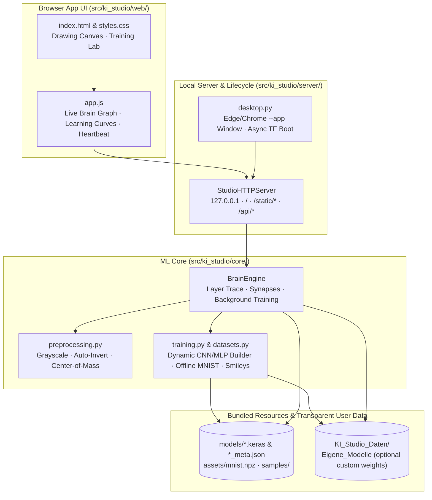

<div align="center">
  

  <h1>TensorFlow KI-Studio</h1>

  <p>
    <strong>Interactive desktop neural network visualizer and offline training lab built with TensorFlow, Keras, and a lightweight browser canvas UI.</strong>
  </p>

  <p>
    
    
    
    
    
    
    <a href="LICENSE"></a>
  </p>
</div>

---

## Overview

**TensorFlow KI-Studio** is an interactive educational desktop application for inspecting, testing, and training convolutional (`CNN`) and multilayer perceptron (`MLP`) neural networks in real time. While drawing with the mouse or loading an image file, the engine traces every forward pass layer by layer—from input pixels through learned `Conv2D` feature maps and hidden `Dense` neurons to excitatory/inhibitory synapse flows and step-by-step Softmax probability math.

The application opens instantaneously via a zero-dependency Python standard-library HTTP server into a frameless desktop browser window while TensorFlow initializes asynchronously in the background. Everything works **100% offline** using the bundled MNIST dataset (`assets/mnist.npz`), factory `.keras` models (`models/`), and local Keras configuration (`assets/keras.json`) without creating hidden files in system or temp folders.

---

## Key Features

- **Handwritten Digit Recognizer (`0–9` / MNIST)**: Draw digits live with brush/eraser controls, pull random MNIST test samples, or upload `.png`/`.jpg`/`.bmp`/`.gif` files. Automatic background inversion, aspect-preserving scaling (`20x20`), and Center-of-Mass alignment normalize any input onto `28x28` pixels.
- **Smiley Happiness Classifier (`0–100 %` / 5 Mood Levels)**: Recognizes *Sehr traurig* (`0 %`), *Etwas traurig* (`25 %`), *Neutral* (`50 %`), *Glücklich* (`75 %`), and *Überglücklich* (`100 %`) drawings (with or without face outlines) and computes a continuous weighted happiness percentage via `compute_happiness_percent()`.
- **Interactive Real-Time Brain Graph**: Renders the full live topology (`Input Grid -> Conv2D Filters -> Hidden Dense Layers -> Softmax Output`), featuring per-node hover inspection with 8×8 receptive/feature-map previews and click-to-inspect output voting (`a_i * w_{i,k}`, logit shift `z - z_max`, and normalized probabilities).
- **Live AI Training & Architecture Lab**: Configure and retrain models directly inside the UI—choosing `0–3` `Conv2D` layers (switch cleanly between CNN and pure MLP), filter counts, `1–2` `Dense` hidden layers (`8–256` units), activation (`ReLU`, `ELU`, `Tanh`, `Sigmoid`), optimizer (`Adam`, `RMSprop`, `SGD`), learning rate, dropout, batch size, epochs, and dataset size—with live epoch learning curves and automatic graph adaptation.
- **Offline-First & Zero Hidden System Files**: Ships with the full 70,000-image MNIST dataset (`assets/mnist.npz`), factory CNN models (`models/zahlen_netz.keras` and `models/smiley_netz.keras`), and `assets/keras.json` (`KERAS_HOME`) so nothing is written to `~/.keras`. Custom trained models live transparently in `KI_Studio_Daten/Eigene_Modelle/` and can be reset or deleted with one click.
- **Modular CLI & Optional Windows Single-File Build**: Includes standalone CLI trainers, terminal/Tkinter image testers, and an optional `.NET Framework` (`csc.exe`) single-file Windows EXE packager (`packaging/windows/build_exe.py`).

---

## Architecture

TensorFlow KI-Studio separates the instant-boot HTTP & desktop window layer from the ML core, preprocessing utilities, and static browser UI:



### Package Overview

| Module / Directory | Responsibility |
| --- | --- |
| `src/ki_studio/config.py` | Domain enums (`ModelMode`, `TrainingTask`), validated/clamped `TrainingConfig` dataclass, logging & TF runtime environment setup |
| `src/ki_studio/paths.py` | Centralized `StudioPaths` resolution across dev, editable install, and frozen EXE modes plus `KI_Studio_Daten/` cleanup helpers |
| `src/ki_studio/core/preprocessing.py` | Image file/byte decoding, auto-inversion, thin-stroke dilation, Center-of-Mass (`28x28`) and geometric (`48x48`) normalization, PNG Base64 encoding |
| `src/ki_studio/core/datasets.py` | Offline MNIST loader (`assets/mnist.npz`), synthetic hand-drawn smiley dataset generator, and continuous mood score helper |
| `src/ki_studio/core/training.py` | Shared CNN/MLP Keras builder (`build_classifier_model`), `LiveTrainingCallback`, unified digit/smiley training pipeline, and quick MNIST test |
| `src/ki_studio/core/engine.py` | `BrainEngine` managing loaded models, layer-by-layer forward-pass inspection, synapse weight contributions, and background training threads |
| `src/ki_studio/server/` | Stdlib `ThreadingHTTPServer` (`http_server.py`) with static asset & path-traversal guards, plus frameless Edge/Chrome `--app` launcher (`desktop.py`) |
| `src/ki_studio/cli/` | Main app launcher (`app.py`), CLI trainers (`train_digits.py`, `train_smiley.py`), quick tester (`quick_test.py`), and shared Tkinter predictors (`tk_canvas.py`, `predict_digits.py`, `predict_smiley.py`) |
| `src/ki_studio/web/` | Separated frontend (`index.html`, `static/css/styles.css`, `static/js/app.js`) |
| `packaging/windows/` | Optional Windows batch launcher (`start_studio.bat`) and single-file EXE packager (`build_exe.py` + `launcher_stub.cs`) |

### Local HTTP API

| Endpoint | Method | Purpose |
| --- | --- | --- |
| `/`, `/index.html`, `/static/*` | `GET` | Serves the single-page studio HTML, CSS, and JavaScript assets |
| `/api/boot`, `/api/status` | `GET` | Reports background TensorFlow boot progress, loaded model metadata, and `KI_Studio_Daten/` info |
| `/api/analyze` | `POST` | Preprocesses a Base64 image and returns activations, receptive/feature maps, Softmax math, and synapse weights |
| `/api/random`, `/api/sample_file` | `POST` | Runs live brain inspection on a random MNIST/smiley sample or a file in `samples/` |
| `/api/train/start`, `/api/train/stop`, `/api/train/status` | `POST` / `GET` | Starts, stops, and streams metrics/logs from `train_digits`, `train_smiley`, or `quick_test` |
| `/api/data/status`, `/api/data/open`, `/api/data/reset`, `/api/data/cleanup_and_exit` | `GET` / `POST` | Inspects, opens, resets custom models to factory weights, or schedules full `KI_Studio_Daten/` cleanup |

---

## Tech Stack

| Layer | Technology | Version / Details |
| --- | --- | --- |
| Language & Packaging | Python / `setuptools` (`pyproject.toml`) | Python `3.10+` (`src/` layout) |
| Deep Learning | TensorFlow / Keras 3 | `tensorflow>=2.16.0` |
| Numerical & Image Ops | NumPy + `tf.image` / `tf.io` | `numpy>=1.26.0` (no Pillow/OpenCV dependency) |
| Local Backend & GUI | Python Stdlib (`http.server`, `threading`, `tkinter`) | Zero third-party server dependencies |
| Web Frontend | Vanilla HTML5, CSS3, ES6+ Canvas 2D | Decoupled static UI served locally on `127.0.0.1` |
| Testing & Linting | `unittest` / `pytest` & `ruff` | `pytest>=8.0`, `ruff>=0.6` (CI on Python 3.11 & 3.12) |
| Windows Packaging (Optional) | .NET Framework C# (`csc.exe`) + WinForms Splash | `packaging/windows/build_exe.py` |

---

## Project Structure

```text
TensorFlow-KI-Studio/
├── .github/workflows/ci.yml               # GitHub Actions CI pipeline (Ruff + pytest)
├── assets/
│   ├── app_icon.ico                       # Windows desktop & taskbar icon
│   ├── icon_256.png                       # High-resolution web & splash icon
│   ├── keras.json                         # Local KERAS_HOME config (prevents ~/.keras creation)
│   ├── mnist.npz                          # Bundled offline MNIST dataset (70,000 images)
│   └── splash.png                         # Splash artwork for optional Windows EXE stub
├── models/
│   ├── smiley_netz.keras                  # Pre-trained 5-class smiley CNN (~98.9% accuracy)
│   ├── smiley_netz_meta.json              # Architecture & training curve metadata
│   ├── zahlen_netz.keras                  # Pre-trained 10-class MNIST CNN (~98.9% accuracy)
│   └── zahlen_netz_meta.json              # Architecture & training curve metadata
├── packaging/windows/
│   ├── build_exe.py                       # Builds dist/TensorFlow_KI_Studio.exe via csc.exe
│   ├── launcher_stub.cs                   # Native WinForms instant splash & payload extractor
│   └── start_studio.bat                   # One-click Windows Python launcher
├── samples/                               # Sample digit and smiley PNG test images
├── src/ki_studio/
│   ├── __init__.py                        # Package version & metadata
│   ├── __main__.py                        # Enables `python -m ki_studio`
│   ├── config.py                          # Enums, TrainingConfig validation, runtime env setup
│   ├── paths.py                           # StudioPaths & transparent KI_Studio_Daten management
│   ├── core/                              # Preprocessing, datasets, ASCII art, training, BrainEngine
│   ├── server/                            # StudioHTTPServer & Edge/Chrome desktop window manager
│   ├── cli/                               # App launcher, training CLIs & shared Tkinter predictors
│   └── web/                               # index.html and static/css/styles.css + static/js/app.js
├── tests/                                 # Automated unit & HTTP/engine integration tests
├── .gitignore
├── LICENSE                                # MIT License
├── pyproject.toml                         # PEP 621 package metadata, entrypoints & Ruff/pytest config
└── requirements.txt                       # Core runtime dependencies
```

---

## Getting Started

### Prerequisites

- **Python 3.10+**
- **TensorFlow** (`>=2.16.0`) and **NumPy** (`>=1.26.0`)
- Optional for desktop app-window mode on Windows: **Microsoft Edge** or **Google Chrome** (falls back automatically to your default browser)

### 1. Installation

Clone the repository and install in editable mode (or install dependencies via `requirements.txt`):

```shell
git clone https://github.com/Paul1708/TensorFlow-KI-Studio.git
cd TensorFlow-KI-Studio
pip install -e .
```

*(Alternatively, install dependencies directly without installing the package: `pip install -r requirements.txt`.)*

### 2. Launch the Studio

```shell
# Installed console entrypoint
ki-studio

# Or run directly as a module (from repo root, set PYTHONPATH=src if not installed)
python -m ki_studio

# Headless server mode (prints the local URL without opening a window)
python -m ki_studio --no-window --port 8080
```

On Windows, you can also launch directly via [`packaging/windows/start_studio.bat`](packaging/windows/start_studio.bat).

### 3. Standalone CLI Tools

All training and prediction workflows can also be invoked independently from the terminal:

```shell
# Quick random MNIST sample check with ASCII visualization
ki-studio-test

# Predict a digit image in the terminal, or omit the path to open the Tkinter canvas
ki-studio-digits samples/beispiel_zahl_8.png
ki-studio-digits

# Predict a smiley image in the terminal, or omit the path to open the Tkinter canvas
ki-studio-smiley samples/smiley_gluecklich.png
ki-studio-smiley

# Retrain custom CNN/MLP models offline (saved into KI_Studio_Daten/Eigene_Modelle/)
ki-studio-train-digits --conv-layers 2 --hidden-units 64 --epochs 4
ki-studio-train-smiley --conv-layers 3 --samples-per-class 2400 --epochs 5
```

### 4. Building the Windows Executable (Optional)

On Windows (uses the built-in `.NET Framework 4.x` C# compiler `csc.exe`, no extra build tools required):

```powershell
python packaging/windows/build_exe.py
```

This creates a compact self-contained launcher at `dist/TensorFlow_KI_Studio.exe` that uses your system Python + TensorFlow installation and keeps runtime/user data isolated in `KI_Studio_Daten/`.

---

## Testing

The test suite under [`tests/`](tests/) covers configuration clamping, `StudioPaths` lifecycle & cleanup guards, image preprocessing & Center-of-Mass alignment, synthetic smiley generation, dynamic CNN/MLP construction, live `BrainEngine` inference against bundled models/samples, and `StudioHTTPServer` REST & path-traversal checks:

```shell
# Standard library test runner (from repo root)
PYTHONPATH=src python -m unittest discover -s tests -v

# Or using pytest + Ruff (with dev extras installed: pip install -e ".[dev]")
ruff check src tests
pytest -v
```

*(In Windows PowerShell, set `$env:PYTHONPATH = "src"` before running `python -m unittest discover -s tests -v` if the package is not installed via `pip install -e .`.)*

---

## License

This project is licensed under the MIT License — see the [LICENSE](LICENSE) file for details.
